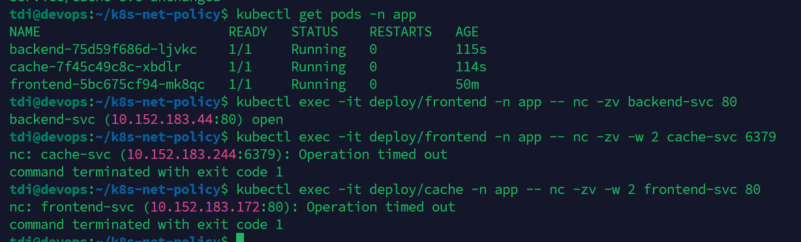

# Реализация сетевых политик (Network Policies) в Kubernetes
Данный репозиторий содержит решение задачи по настройке сетевой безопасности внутри кластера Kubernetes

## Задача
Необходимо настроить сетевую изоляцию для трех компонентов приложения, развернутых в одном namespace (app), чтобы обеспечить строго определенную цепочку взаимодействия:
frontend → backend → cache

## Компоненты:
* Namespace: app
* Frontend: Deployment + Service (порт 80)
* Backend: Deployment + Service (порт 80). Слушает входящие соединения от Frontend.
* Cache: Deployment + Service (порт 6379). Слушает входящие соединения только от Backend.

## Проверка работы
Для проверки использовалась утилита nc (netcat). Ниже приведены результаты тестов:
### 1. Разрешенный трафик (Frontend → Backend)
Соединение должно быть успешно установлено.
```bash
$ kubectl exec -it deploy/frontend -n app -- nc -zv backend-svc 80
backend-svc (10.152.183.44:80) open
```

### 2. Запрещенный трафик (Frontend → Cache)
Попытка прямого доступа к кэшу должна завершиться по таймауту (пакеты дропаются).
```bash
$ kubectl exec -it deploy/frontend -n app -- nc -zv -w 2 cache-svc 6379
nc: cache-svc (10.152.183.244:6379): Operation timed out
```

### 3. Запрещенный трафик (Cache → Frontend)
Попытка инициировать соединение с фронтендом должна быть заблокирована.
```bash
$ kubectl exec -it deploy/cache -n app -- nc -zv -w 2 frontend-svc 80
nc: frontend-svc (10.152.183.172:80): Operation timed out
```

---

Скриншоты результатов


---

Манифесты:
- [Deployment](./apps.yaml)
- [NetworkPolicy](./policies.yaml)
